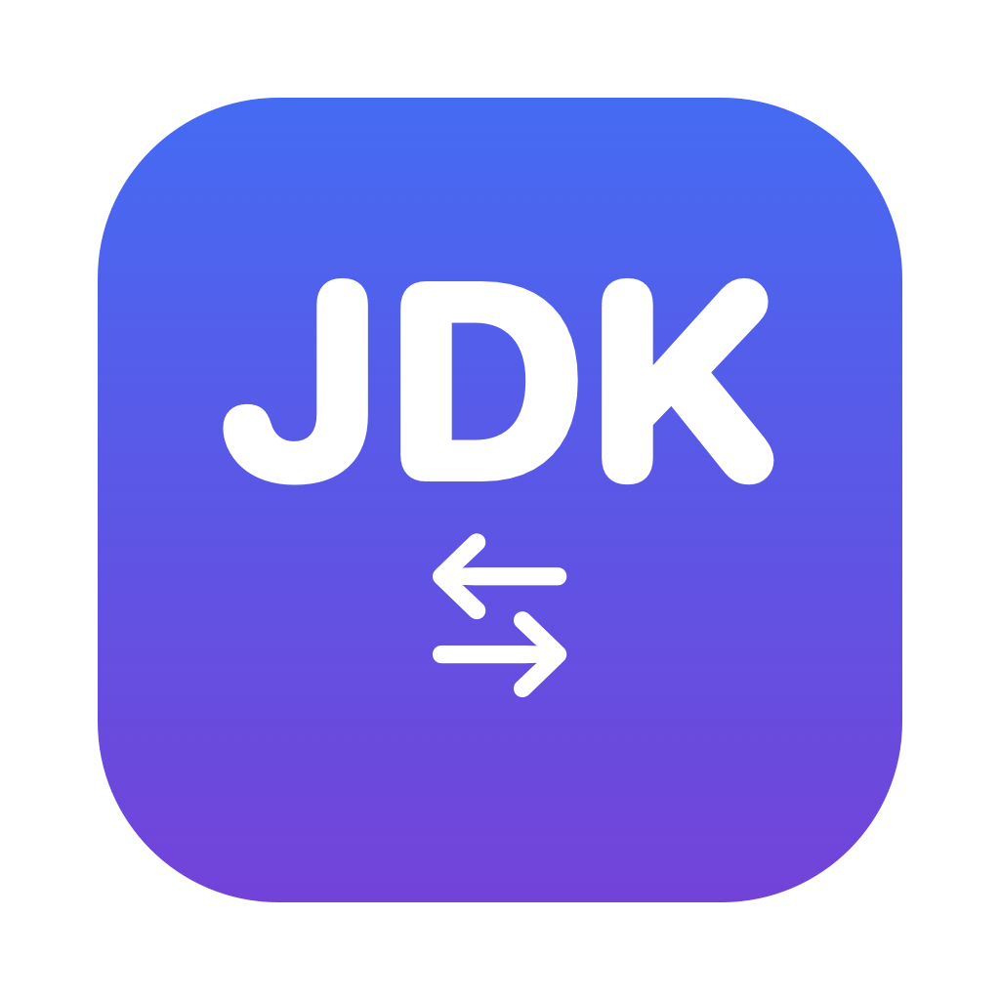

<p align="center">
  
</p>

<h1 align="center">JDK Switcher</h1>

<p align="center">
  Switch the JDK Flutter uses from the menu bar, on your Mac only.<br>
  Nothing is written to your project, so teammates' builds never break.
</p>

<p align="center">
  <a href="https://github.com/haonlabs/jdk-switcher/releases/latest"><b>Download the latest release</b></a>
</p>

---

## Why

Flutter projects don't all build with the same JDK. Older ones on Gradle 7 need JDK 17, newer ones want
21, and Android Studio now bundles JDK 25. The usual fixes are a poor fit:

| Fix | Problem |
|---|---|
| Set `JAVA_HOME` (or use SDKMAN / mise / jenv) | Flutter ignores it. It picks Android Studio's bundled JDK first. |
| Add `org.gradle.java.home=…` to `android/gradle.properties` | It's committed, so a path that only exists on your Mac (e.g. Homebrew) breaks everyone else. |
| Run `flutter config --jdk-dir …` | Works, but you have to remember the full JDK path every time you switch. |

JDK Switcher does the third one for you: pick a JDK in the menu bar, and it sets Flutter's `jdk-dir` in
`~/.config/flutter/settings`. That file is per user, so it applies only to your Mac and to every
Flutter version on it, including ones installed with FVM.

## Features

- Lives in the menu bar. The badge shows the active major version: `J17`, `J21`, `J25`, …
- Finds JDKs from Android Studio, Homebrew, `/Library/Java/JavaVirtualMachines`, SDKMAN, mise and asdf.
- **Default (Android Studio)** removes the override, so Flutter goes back to its own choice.
- **Launch at Login**, using the native macOS login item API.
- A small CLI for scripts: `--list` and `--set`.
- Never touches project files. It only changes the one `jdk-dir` key and keeps every other Flutter setting.
- Universal binary (Apple Silicon and Intel), macOS 13 Ventura or later.

## Install

1. Download `JDKSwitcher-<version>.dmg` from [Releases](https://github.com/haonlabs/jdk-switcher/releases/latest).
2. Open it and drag **JDK Switcher** into **Applications**.
3. Launch it from Applications. The badge appears in the menu bar.

### "JDK Switcher can't be opened" / "Apple could not verify…"

Release builds aren't notarized by Apple yet, so Gatekeeper blocks the first launch. Allow it once, either:

- Open **System Settings → Privacy & Security**, scroll down, and click **Open Anyway** next to JDK Switcher, or
- run this in Terminal:

  ```sh
  xattr -dr com.apple.quarantine "/Applications/JDK Switcher.app"
  ```

Prefer not to trust a binary? [Build it yourself](#build-from-source). It takes about a minute.

## Usage

Click the menu bar badge:

| Item | What it does |
|---|---|
| **Default (Android Studio)** | Remove the override. Flutter uses Android Studio's bundled JDK. |
| **JDK 17.0.21 — Homebrew**, … | Make Flutter use this JDK. The checkmark shows the active one. |
| **Refresh** ⌘R | Rescan after installing or removing a JDK |
| **Launch at Login** | Start JDK Switcher when you log in |
| **Quit JDK Switcher** ⌘Q | Quit. The selected JDK stays active. |

Then build as usual (`flutter run`, `fvm flutter build apk`, VS Code). Check with `flutter doctor -v`,
which prints the Java binary and version under *Android toolchain*.

### Command line

```sh
JS="/Applications/JDK Switcher.app/Contents/MacOS/JDKSwitcher"
"$JS" --list          # detected JDKs and the current one
"$JS" --set 17        # by major version
"$JS" --set /path/to/jdk/Contents/Home
"$JS" --set default   # back to Android Studio's JDK
```

## How it works

Flutter picks the JDK for Android builds in this order:

1. `jdk-dir` from `flutter config` (stored in `~/.config/flutter/settings`)
2. The JDK bundled with Android Studio
3. `JAVA_HOME`
4. `java` on your `PATH`

JDK Switcher only reads and writes the first one, the same key `flutter config --jdk-dir` sets. If the file
isn't valid JSON, it refuses to write instead of overwriting your other settings.

The source is a few small files:

```
Sources/main.swift          menu bar UI, Launch at Login, CLI
Sources/JDKStore.swift      JDK discovery, Flutter settings read/write
Tests/main.swift            self-check for discovery and the settings file
scripts/make-icon.swift     draws the app icon
build.sh                    builds the .app and .dmg
```

## Build from source

Requirements: macOS 13+ and the Xcode Command Line Tools (`xcode-select --install`). Full Xcode isn't needed.

```sh
git clone https://github.com/haonlabs/jdk-switcher.git
cd jdk-switcher
./build.sh
```

This runs the self-check, compiles a universal binary, draws the icon, signs the app ad hoc, and creates:

- `build/JDK Switcher.app`
- `build/JDKSwitcher-<version>.dmg`

The version comes from `CFBundleShortVersionString` in `Info.plist`.

### Signed and notarized builds

With an Apple Developer account, set these and the build is signed with your Developer ID and the DMG is
notarized and stapled, so users get no Gatekeeper warning:

```sh
xcrun notarytool store-credentials jdk-switcher   # once
SIGN_ID="Developer ID Application: Your Name (TEAMID)" NOTARY_PROFILE=jdk-switcher ./build.sh
```

## Troubleshooting

**Android Studio still builds with another JDK.** Builds started from Android Studio use its own setting:
Settings → Build, Execution, Deployment → Build Tools → Gradle → **Gradle JDK**. JDK Switcher covers the
`flutter` CLI and editors that call it, such as VS Code.

**My JDK isn't listed.** Click **Refresh**. If it's installed somewhere else, use
`--set /path/to/Home`. The menu shows it as *Custom*.

**Launch at Login doesn't stick.** Make sure the app runs from `/Applications`, and allow it under
System Settings → General → Login Items.

## Known limitations

- The choice is global for your user, not per project. Switch when you move to a project that needs another JDK.
- Only Flutter reads `jdk-dir`. Plain Gradle or Android Studio builds aren't affected.

## Contributing

Issues and pull requests are welcome. Please keep it small: JDK Switcher aims to stay a few hundred lines
with no dependencies. Run `./build.sh` before opening a PR; it fails if the self-check fails.
When you add a JDK location, add a case to `Tests/main.swift` if it changes how homes are recognized.

## License

[MIT](LICENSE)
